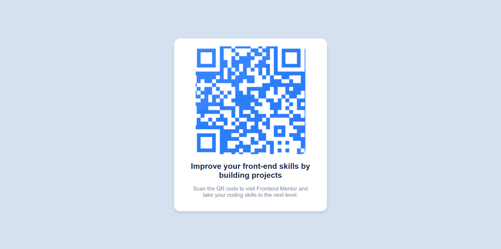

# QR Code Component - Frontend Mentor Challenge

This project is a solution to the [QR code component](https://www.frontendmentor.io/challenges/qr-code-component-iux_sIO_H) challenge on _Frontend Mentor_.  
This challenge helped me practice my skills in **HTML** and **CSS**, while applying _responsive design_ techniques.

---

## **Project Overview**

### **Live Site:** [View the project](https://joyful-rugelach-d816cc.netlify.app)

### **Screenshot:**

---

## **Technologies Used**

- **HTML5**
- **CSS3**
- **Flexbox**
- **Media Queries**
